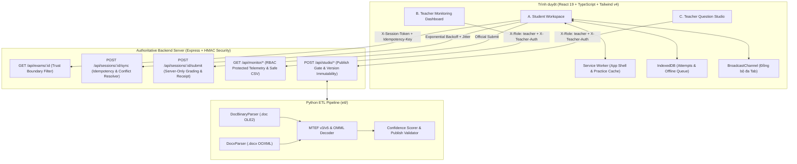

# Tài Liệu Kiến Trúc Hệ Thống (System Architecture)

Tài liệu này mô tả chi tiết kiến trúc của **KhaoThi Precision Suite v2.0**, đảm bảo tuân thủ nghiêm ngặt Mục 5 (Product Design & Motion Engine) và Mục 6 (Architecture, Security & Data Integrity).

---

## 1. Sơ Đồ Kiến Trúc Tổng Thể

---

## 2. Phân Tách Ranh Giới Tin Cậy (Trust Boundaries - Mục 6.1)

Hệ thống tách biệt rõ ràng hai chế độ vận hành trong [`grading-engine.ts`](file:///c:/Users/Darne/Downloads/The%20Fragrent/src/lib/grading-engine.ts) và [`server/app.ts`](file:///c:/Users/Darne/Downloads/The%20Fragrent/server/app.ts):

| Tiêu chí | Practice Mode (Luyện tập) | Exam Mode (Thi chính thức) |
|---|---|---|
| **Dữ liệu đáp án (`answer_key`)** | Được gửi xuống client để hỗ trợ chấm thử tức thì. | **Bị loại bỏ hoàn toàn trên Server** trước khi trả JSON về client (`prepareExamForClient`). |
| **Lời giải chi tiết (`explanation`)** | Hiển thị ngay khi thí sinh bấm kiểm tra. | **Bị loại bỏ hoàn toàn** khi đang làm bài; chỉ trả về trong biên lai sau khi Server đã khóa phiên nộp bài. |
| **Nguồn xác thực điểm số** | Cho phép chấm cục bộ trên trình duyệt (kể cả khi mất mạng). | **Server là nguồn chân lý duy nhất**. Mọi trường điểm số do client gửi lên trong payload đều bị bỏ qua và ghi vào nhật ký kiểm toán (`TAMPERED_SCORE_PAYLOAD_IGNORED`). |
| **Kiểm soát thời gian & phiên** | Linh hoạt theo người học. | Khóa theo `expires_at_server` + `grace_period_seconds`, xác thực bằng chữ ký `HMAC-SHA256` (`X-Session-Token`). |

---

## 3. Độ Tin Cậy & Đồng Bộ Dữ Liệu (Reliability Engine - Mục 6.3)

Được triển khai tại [`src/lib/reliability.ts`](file:///c:/Users/Darne/Downloads/The%20Fragrent/src/lib/reliability.ts) và [`public/sw.js`](file:///c:/Users/Darne/Downloads/The%20Fragrent/public/sw.js):

1. **Lưu trữ tức thì vào IndexedDB (`ExamIndexedDBStore`)**:
   - Ngay khi thí sinh chọn đáp án hoặc đánh dấu câu hỏi, trạng thái được tăng số thứ tự đơn điệu (`sequence_number++`) và ghi ngay lập tức vào object store `attempts` của IndexedDB (kèm bản sao dự phòng trong `localStorage` để chống mất dữ liệu khi trình duyệt bị đóng đột ngột).
2. **Trạng thái đồng bộ trung thực (`HonestSyncStatus`)**:
   - Giao diện tuyệt đối không hiển thị `"Đã đồng bộ Server"` khi mới chỉ lưu ở client.
   - Hệ thống phân tách rõ:
     - `saved_local`: Đã lưu vào IndexedDB cục bộ, đang chờ phản hồi từ Server.
     - `syncing`: Đang gửi gói tin đồng bộ.
     - `synced_ack`: Đã nhận được `ack_id` và `server_timestamp` hợp lệ từ Server.
     - `offline_queued`: Đang mất mạng; thao tác đã được xếp vào hàng đợi `sync_queue` trong IndexedDB.
3. **Thử lại với Exponential Backoff và Full Jitter**:
   - Công thức tính thời gian chờ giữa các lần thử lại:
     $$T_{\text{sleep}} = \text{random}\left(0, \min\left(T_{\max}, T_{\text{base}} \cdot 2^{\text{attempt}}\right)\right)$$
   - Giúp tránh hiện tượng nghẽn cổ chai (thundering herd) khi hàng nghìn thí sinh có mạng trở lại cùng lúc.
4. **Đồng bộ đa tab qua `BroadcastChannel` (`MultiTabCoordinator`)**:
   - Khi thí sinh mở hai tab cùng một phiên thi, mọi thay đổi đáp án được phát qua kênh `khaothi_session_<sessionId>`.
   - Hàm `resolveAnswerConflicts` hợp nhất trạng thái dựa trên `sequence_number` lớn hơn (và `client_updated_at` nếu trùng số thứ tự), đồng thời hiển thị thanh cảnh báo đa tab rõ ràng.

---

## 4. Ba Trải Nghiệm Người Dùng Tách Biệt (Mục 5.6)

1. **A. Student Workspace ([`StudentWorkspace.tsx`](file:///c:/Users/Darne/Downloads/The%20Fragrent/src/components/StudentWorkspace.tsx))**:
   - Tập trung hoàn toàn vào việc đọc đề và làm bài: chế độ Focus Mode thu gọn thanh điều hướng, đồng hồ đếm ngược đồng bộ thời gian thực với Server, bản đồ câu hỏi dùng kết hợp màu sắc + viền + biểu tượng (đạt chuẩn WCAG 2.2 AA), phóng to hình vẽ SVG (`ImageZoomModal`), điều hướng bàn phím (`←/→`, `1-4`, `F`, `M`, `Esc`).
2. **B. Teacher Monitoring Dashboard ([`TeacherMonitoringDashboard.tsx`](file:///c:/Users/Darne/Downloads/The%20Fragrent/src/components/TeacherMonitoringDashboard.tsx))**:
   - Dành riêng cho giám thị và giáo viên: lưới thí sinh trực tuyến, bộ lọc đa tiêu chí, tìm kiếm & sắp xếp, biểu đồ phân tích độ khó từng câu, dòng thời gian sự kiện trình duyệt trung lập, xuất CSV an toàn và ngăn kéo xem chi tiết từng thí sinh.
3. **C. Teacher Question Studio ([`TeacherQuestionStudio.tsx`](file:///c:/Users/Darne/Downloads/The%20Fragrent/src/components/TeacherQuestionStudio.tsx))**:
   - Dành riêng cho tác giả biên soạn đề: nhập file Word `.doc` / `.docx` qua Python ETL, kiểm tra mã hex gốc của công thức MTEF v3/v5, xem trước công thức KaTeX và hình vẽ SVG, xác minh đáp án thủ công, báo cáo kiểm định (`Validation Report`) và quản lý lịch sử phiên bản đề bất biến.
