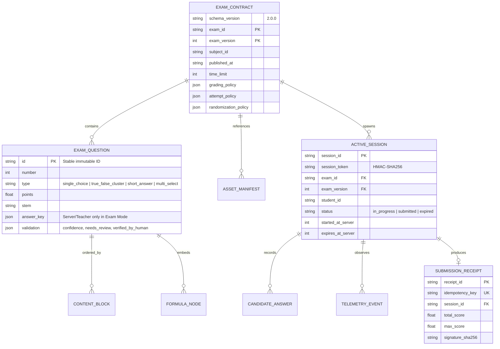

# Thiết Kế Cơ Sở Dữ Liệu & Hợp Đồng Dữ Liệu (Database Schema)

Hệ thống sử dụng mô hình dữ liệu đa tầng kết hợp giữa **Server Store / Firestore Collections** (có phân tách quyền đọc qua [`firestore.rules`](file:///c:/Users/Darne/Downloads/The%20Fragrent/firestore.rules)) và **Client IndexedDB (`KhaoThiReliabilityDB_v2`)**.

---

## 1. Sơ Đồ Thực Thể Liên Kết (ER Diagram)

---

## 2. Cấu Trúc IndexedDB Trên Trình Duyệt (`KhaoThiReliabilityDB_v2`)

Được định nghĩa tại [`src/lib/reliability.ts`](file:///c:/Users/Darne/Downloads/The%20Fragrent/src/lib/reliability.ts):

1. **Object Store `attempts` (`keyPath: "session_id"`)**:
   - Lưu toàn bộ trạng thái bài làm hiện tại của thí sinh (`answers`, `question_order`, `option_orders`, `clock_drift_ms`, `last_ack_id`, `last_ack_server_timestamp`).
   - Cho phép khôi phục 100% trạng thái bài làm ngay lập tức sau khi trình duyệt bị crash, đóng tab hoặc mất nguồn.
2. **Object Store `sync_queue` (`keyPath: "idempotency_key"`)**:
   - Lưu danh sách các gói tin đồng bộ (`autosave_sync` hoặc `final_submit`) chưa nhận được xác nhận `ACK` từ Server khi mất mạng.
   - Tự động xả hàng đợi theo cơ chế Exponential Backoff + Full Jitter ngay khi sự kiện `online` kích hoạt.

---

## 3. Quy Tắc Phiên Bản Hóa & Di Trú Schema (Mục 6.2)

- Mọi đề thi bắt buộc tuân thủ `schema_version: "2.0.0"` với đầy đủ 11 trường cốt lõi: `schema_version`, `exam_id`, `exam_version`, `subject_id`, `published_at`, `time_limit`, `grading_policy`, `attempt_policy`, `randomization_policy`, `questions`, `assets_manifest`.
- Công cụ [`migrateExamSchema`](file:///c:/Users/Darne/Downloads/The%20Fragrent/src/lib/schema-migration.ts) hỗ trợ tự động chuyển đổi dữ liệu đề thi từ phiên bản cũ (`v1.0` / `v1.0.0`) sang `v2.0.0`, tự động cấp phát mã định danh ổn định (`stable ID`) cho từng câu hỏi và phương án lựa chọn.
- **Tính bất biến của phiên bản đề đang thi**: Khi một `exam_version` đang có phiên thi ở trạng thái `in_progress`, hệ thống khóa mọi thao tác sửa trực tiếp lên phiên bản đó. Mọi chỉnh sửa trong Question Studio sẽ tạo ra `exam_version + 1` mới.
